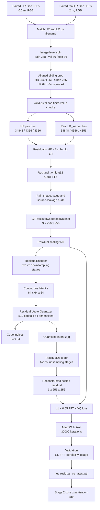
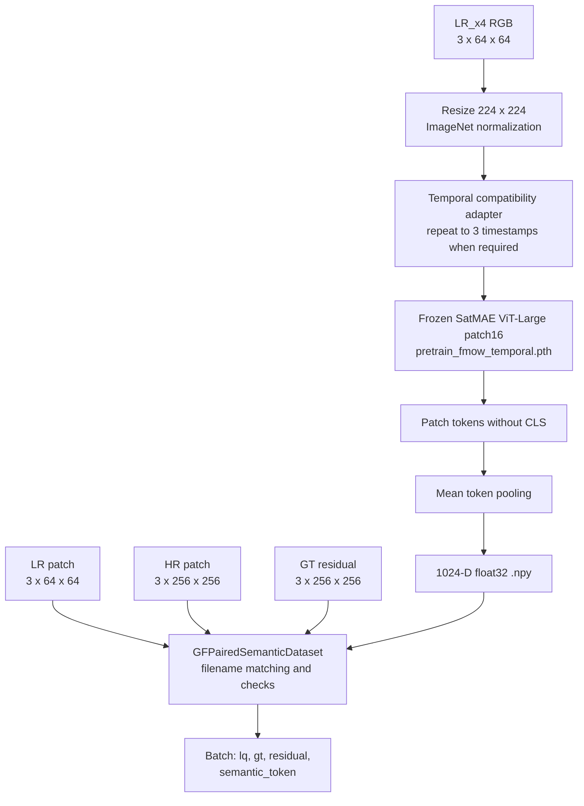
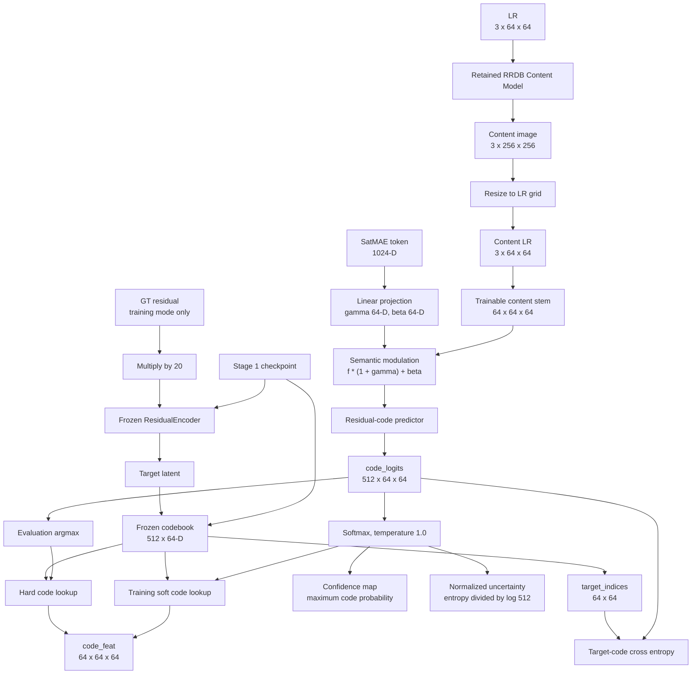
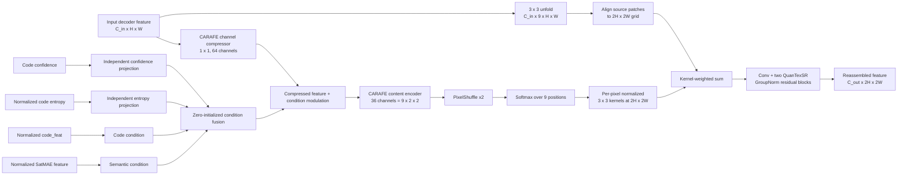
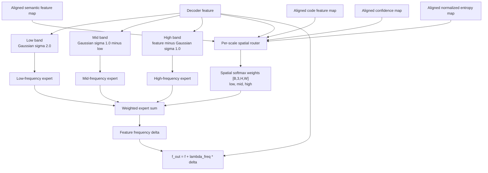
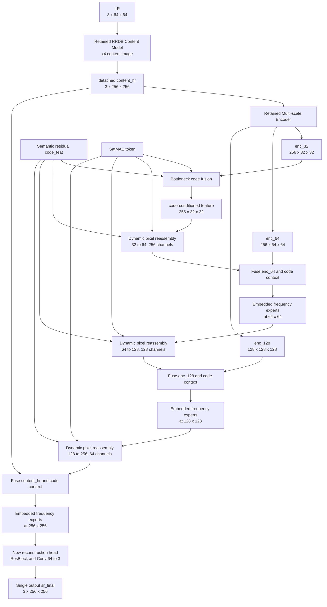
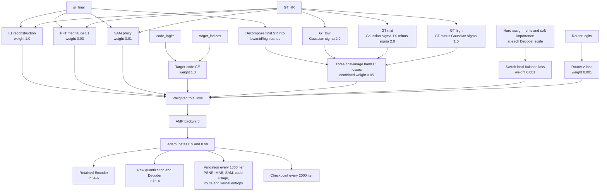

# Training Options

## GeoCodeSR RGB pipeline

The paired RGB dataset root is `E:/GeoCodeSR/tuihua_paired_x4`. The current task uses
three input/output channels, real paired 2 m LR and 0.5 m HR images, and scale x4.

Training options:

1. `train_residual_vq_codebook_tuihua_rgb.yml`: Stage 1 residual VQ pretraining.
2. `train_geocodesr_baseline_tuihua_rgb.yml`: rebuilt encoder-decoder baseline.
3. `train_semantic_codebook_sr_satmae_tuihua_rgb.yml`: residual-code retrieval with static reassembly.
4. `train_semantic_dynamic_kernel_sr_satmae_tuihua_rgb.yml`: retrieval plus dynamic pixel reassembly.
5. `train_semantic_frequency_expert_sr_satmae_tuihua_rgb.yml`: full single-path GeoCodeSR.

The original QuanTexSR options are retained only for reproducing the external original-model baseline.
Full GeoCodeSR does not contain a complete QuanTexSR bypass.

## Stage 1: paired data and residual VQ pretraining

Stage 1 builds leakage-free paired patches and learns the high-frequency residual codebook.
SatMAE tokens are not consumed by the residual VQ model in this stage.

Stage 1 files:

- `scripts/data_preparation/generate_paired_lr_hr_residual_image_split.py`
- `scripts/data_preparation/check_gf_image_level_dataset.py`
- `basicsr/data/gf_residual_codebook_dataset.py`
- `basicsr/archs/gf_residual_vqvae_arch.py`
- `scripts/train/train_residual_vq_codebook.py`
- `options/train_residual_vq_codebook_tuihua_rgb.yml`

## Stage 2: single-path backbone-level GeoCodeSR rebuild

Stage 2 retains only two pretrained feature extractors from QuanTexSR:

- RRDB Content Model.
- Multi-scale Encoder.

The following original QuanTexSR modules are directly replaced and do not exist in the Full model:

- Native texture `quantize_group`, `before_quant_group`, and `after_quant_group`.
- Original `SimSFT` fusion blocks.
- Original `DecoderBlock` modules and their fixed `Upsample` operations.
- Original reconstruction `out_conv`.
- Complete original QuanTexSR bypass output.

### 2.1 Offline SatMAE tokens and paired batch

SatMAE is frozen and runs offline. GeoCodeSR reads one cached 1024-D mean token per LR patch.

### 2.2 New core quantization path

The Stage 1 codebook replaces the original texture quantizer as the only quantization path.
The encoder and codebook loaded from Stage 1 are frozen; the semantic code predictor is trainable.

`ResidualEncoder` is a target-label generator only. It runs under `torch.no_grad()` only when
the model is in training mode and `residual_gt` is supplied. Validation and inference never call
the target encoder and reconstruct SR solely from LR plus the cached semantic token.

Scale alignment and channel projection are explicit and stage-specific:

| Scale | Main feature | `code_feat` alignment | Semantic alignment | Confidence/uncertainty alignment |
|---|---|---|---|---|
| 32 bottleneck | 256 x 32 x 32 | 64 to 256 channels, bilinear 64 to 32 | 1024 to 256, spatial expansion | confidence and normalized entropy independently resized 64 to 32 |
| 64 Decoder | 256 x 64 x 64 | 64 to 256 channels, native 64 grid | 1024 to 256, spatial expansion | confidence and normalized entropy remain on the 64 grid |
| 128 Decoder | 128 x 128 x 128 | 64 to 128 channels, bilinear 64 to 128 | 1024 to 128, spatial expansion | confidence and normalized entropy independently resized 64 to 128 |
| 256 Decoder | 64 x 256 x 256 | 64 to 64 channels, bilinear 64 to 256 | 1024 to 64, spatial expansion | confidence and normalized entropy independently resized 64 to 256 |

The four independent adapters are `condition_align_32`, `condition_align_64`,
`condition_align_128`, and `condition_align_256`. For each dynamic reassembly predictor at
input scales 32, 64, and 128, code, semantic, confidence, and normalized entropy are projected
independently and fused as a zero-initialized modulation of the CARAFE compressed feature.
No condition relies on implicit spatial broadcasting.

At the bottleneck and the three Decoder output scales, `GatedCodeSkipFusion` replaces SimSFT.
It predicts independent skip and code gates from decoder, skip, aligned code, aligned semantic,
confidence, and entropy features, then reports each gate mean and response mean for auditing.

### 2.3 Code-response-driven dynamic pixel reassembly

Each decoder stage uses an x2 reassembly module following the official CARAFE pack structure.
There is no fixed nearest/bilinear
upsampling in the Full Decoder main path. Internal nearest expansion only aligns unfolded source
patches with the output grid; the output value is determined by the predicted normalized kernel.

### 2.4 Decoder-embedded semantic-codebook frequency experts

Low/mid/high experts are applied inside every Decoder stage, not after image reconstruction.
Each scale uses a spatial router. It outputs `[B, 3, H, W]` weights and normalizes the three
experts independently at every spatial position. The innovation is therefore region-adaptive
semantic-codebook joint routing rather than image-level correction.
The feature, code, and semantic inputs are normalized before routing. Experts use the
GroupNorm pre-activation residual design from the QuanTexSR Decoder and zero-initialized output
projections. Router logits are regularized with the standard router z-loss; no entropy floor,
logit clamp, or expert-output clipping is used.

### 2.5 Full single reconstruction path

There is no `sr_base` or `sr_enhanced` bypass output. Full GeoCodeSR has one reconstruction result.

### 2.6 Losses, optimizer, and validation

Full-model states:

| Module | Source | State |
|---|---|---|
| RRDB Content Model | Original QuanTexSR checkpoint | Frozen; output detached as in official LQ path |
| Multi-scale Encoder | Original QuanTexSR checkpoint | Trainable, low LR |
| Original texture Quantizer/SFT/Decoder/head | Replaced | Not instantiated |
| ResidualEncoder | Stage 1 checkpoint | Frozen, training target path only |
| 512 x 64 residual codebook | Stage 1 checkpoint | Frozen, prediction lookup and training target lookup |
| Semantic residual-code predictor | New | Trainable |
| Three dynamic pixel reassembly stages | New | Trainable |
| Three code/skip fusion stages plus bottleneck fusion | New | Trainable |
| Three routed frequency-expert groups | New | Trainable |
| New reconstruction head | New | Trainable |
| SatMAE | Temporal checkpoint | Frozen, offline only |

Stage 2 files:

- `scripts/features/extract_satmae_tokens.py`
- `basicsr/data/gf_paired_semantic_dataset.py`
- `basicsr/archs/gf_semantic_frequency_expert_sr_arch.py`
- `scripts/train/train_semantic_frequency_expert_sr.py`
- `scripts/inference/infer_semantic_frequency_expert_sr.py`
- `options/train_semantic_frequency_expert_sr_satmae_tuihua_rgb.yml`

## Progressive ablations

All GeoCodeSR ablations use the rebuilt single path. The original QuanTexSR is evaluated separately.

| Experiment | Residual code retrieval | Dynamic reassembly | Embedded frequency experts |
|---|---:|---:|---:|
| A Rebuilt baseline | false | false, fixed-center reassembly | false |
| B Core quantization | true | false, fixed-center reassembly | false |
| C Dynamic Decoder | true | true | false |
| D Full GeoCodeSR | true | true | true |

When dynamic reassembly is disabled for an ablation, the same reassembly operator uses a fixed
center kernel. This ablation behavior does not add the removed original Decoder back into the model.

## Original QuanTexSR reference options

- `train_QuanTexSR_HQ_pretrain_stage.yml`
- `train_QuanTexSR_LQ_stage.yml`
- `train_QuanTexSR_semantic_cluster_stage.yml`
